# 05 — BIR Requirements Gate & Development Workflow

> Source: Notion — EIS (https://app.notion.com/p/41cd71c0838d812fa92adb609be3a374) · Exported 2026-11-19

This is the regulatory-first workflow for deciding what must be done before EIS SaaS development can safely proceed. It focuses on requirements **for the SaaS provider** and requirements **for each taxpayer/customer**. It is a planning document, not legal advice or confirmation of BIR approval.

## Executive finding — resolve this before committing to the MVP

The proposed product is a SaaS offered to multiple independent businesses. If it provides e-invoicing, electronic sales reporting, invoice validation, storage, middleware, migration or related services to taxpayers, it may fall within the Electronic Invoicing Service Provider (ESP) framework under RMC No. 110-2026.

RMC No. 110-2026 says an ESP may not commercially deploy, activate or provide covered e-invoicing solutions/services unless the solution has BIR accreditation and a valid Electronic Invoicing Solutions Accreditation Certificate. Accreditation is solution-specific: it applies to the approved solution, version, modules, interfaces and deployment configuration.

**Potential eligibility blocker:** professional summaries of RMC 110-2026 report that applicants must demonstrate, for each of the immediately preceding three years, systems capable of processing at least 5 million transactions annually and supporting at least 1,000 active user/customer accounts annually. The exact wording, interpretation, exceptions and evidence must be checked against the signed circular and Annex A with BIR and Philippine tax counsel. A new startup may not satisfy this test on its own.

The BIR's tax advisory extended the application deadline to **December 1, 2026**. This is time-sensitive. If the business cannot qualify, do not assume that a new startup can bypass ESP accreditation by calling the product an upload portal. Obtain written/qualified advice on whether a partnership with an already accredited ESP is possible and what responsibilities remain with us.

## 1. Keep three different regulatory tracks separate

| Track | Applies to | What it means |
| --- | --- | --- |
| ESP accreditation | Our SaaS provider and the specific solution | BIR approval before commercially deploying covered third-party e-invoicing services |
| PTI Electronic Invoice | Each taxpayer/business | Taxpayer's authority to issue electronic invoices through the identified approved software/system |
| EIS Certification | Taxpayer's invoicing system / applicable solution | Validation of capability to extract, process and transmit invoice/sales data under BIR technical standards |
| Permit to Transmit (PTT) | Taxpayer when BIR directs electronic sales reporting | RMC 98-2026 says PTT applies only upon notification/directive by the CIR for Section 237-A reporting |

Do not treat ESP accreditation, PTI, EIS Certification and PTT as interchangeable. One does not automatically replace the others. Confirm with BIR how a customer using an accredited ESP completes the taxpayer-side PTI and EIS Certification steps.

## 2. Regulatory-first workflow diagram

```mermaid
flowchart TD
    A["Start: define intended SaaS service"] --> B["Classify the service under RMC 110-2026"]
    B --> C{"Does it provide covered services to multiple taxpayers?"}
    C -->|"Yes / likely"| D["Treat as prospective ESP until clarified"]
    C -->|"Unclear"| D1["Obtain written BIR / tax counsel classification"]
    D1 --> D
    D --> E["Read RMC 110-2026 and Annex A in full"]
    E --> F{"Can the applicant meet legal, financial, track-record and personnel criteria?"}
    F -->|"No / uncertain"| G["Stop commercial ESP route; assess accredited-provider partnership"]
    F -->|"Yes"| H["Assess application window and submit complete provider application"]
    G --> I["Confirm partnership model, responsibilities and data flows with counsel/BIR"]
    H --> J["BIR documentary completeness review"]
    I --> K["Agree permitted architecture and responsibilities"]
    J --> L["Fit-and-proper and financial capacity review"]
    L --> M["Technical architecture and end-to-end data-flow review"]
    M --> N["Privacy, cybersecurity and data-residency assessment"]
    N --> O["System demonstration"]
    O --> P["Interoperability and end-to-end transmission testing"]
    P --> Q["Load, stress, scalability, concurrency, failover, backup and recovery tests"]
    Q --> R{"All mandatory stages passed?"}
    R -->|"No"| S["Remediate and retest"]
    S --> Q
    R -->|"Yes"| T["BIR issues solution-specific accreditation"]
    K --> U["Build only approved / contractually permitted integration path"]
    T --> U
    U --> V["Confirm taxpayer onboarding requirements"]
    V --> W["Per taxpayer: determine coverage and registered entities/branches"]
    W --> X["Taxpayer obtains PTI Electronic Invoice before e-invoice issuance"]
    X --> Y["Complete taxpayer/system EIS Certification within applicable period"]
    Y --> Z{"Has BIR directed Section 237-A electronic sales reporting?"}
    Z -->|"No"| AA["Do not assume PTT or monthly sales reporting is currently required"]
    Z -->|"Yes"| AB["Taxpayer follows current BIR reporting rules and obtains PTT if required"]
    AA --> AC["Finalize product requirements and approved data model"]
    AB --> AC
    AC --> AD["Only then finalize build scope, BIR connector and production launch gates"]
```

The diagram is deliberately stage-gated. A successful prototype or a submitted application is not the same as accreditation or permission for production use.

## 3. Our provider-side requirements checklist

### Gate A — classify our business model

- [ ] Describe exactly what the SaaS does: invoice generation/issuance, invoice data intake, validation, storage, transformation, transmission, reporting, customer access and migration.
- [ ] Determine which of these activities are covered by the ESP definition and RMC 110-2026.
- [ ] Confirm whether a multi-tenant SaaS serving unrelated businesses is an ESP solution.
- [ ] Obtain a written assessment from Philippine tax counsel and seek BIR clarification where needed.
- [ ] Decide whether we apply as an ESP, partner with an accredited ESP, or change the initial service scope.

**Exit evidence:** written provider-classification and operating-model decision.

### Gate B — test eligibility before building for accreditation

Review the signed RMC 110-2026 and Annex A for every qualification. At minimum, investigate:

- Legal entity, registration and tax-compliance standing.
- Beneficial ownership, directors, officers and key personnel disclosures.
- Designated technical and compliance focal persons.
- Financial capacity and operational sustainability.
- Independently verifiable operating history and transaction/account thresholds.
- Infrastructure, staffing, insurance/bond or other financial safeguards if specified.
- Subcontractors, affiliates, cloud providers, hosting locations and foreign processors.
- Documentary checklist and application window.

- [ ] Obtain the signed RMC 110-2026 and official Annex A directly from BIR.
- [ ] Map every checklist item to evidence we already possess.
- [ ] Mark each item met / gap / not applicable / needs BIR interpretation.
- [ ] Validate the reported three-year track-record thresholds against the primary source.
- [ ] Ask BIR whether any eligibility pathway, consortium or partnership arrangement is recognized.
- [ ] Record the December 1, 2026 deadline and verify whether our application can realistically be complete by then.

**Exit evidence:** eligibility assessment and go/no-go decision. Do not spend the MVP budget assuming accreditation is attainable until this gate is passed.

### Gate C — prepare the solution evidence pack

The circular describes a stage-gated assessment, not a paperwork-only approval. Prepare the solution and evidence needed for:

1. Documentary completeness review.
2. Fit-and-proper and financial capacity review.
3. Technical architecture and end-to-end data-flow review.
4. Data privacy, cybersecurity and data-residency assessment.
5. Live system/solution demonstration.
6. Interoperability and end-to-end transmission testing.
7. Load, stress, scalability, concurrency, failover, backup and recovery testing.

Evidence areas to investigate in Annex A and with BIR include:

- Legal/corporate documents, tax compliance and financial statements.
- System overview, features/specifications, supported modules and version.
- Architecture and end-to-end data-flow diagrams.
- Hosting, infrastructure, data location and third-party provider disclosures.
- Data governance, access controls, encryption, auditability and data portability.
- Security policies, incident response, source-code review and VAPT evidence.
- Relevant information-security certifications or accepted equivalents.
- Business continuity, disaster recovery, backup and restoration evidence.
- Service levels, support model, operational monitoring and escalation.
- Sample invoices, reports, logs and machine-readable data exports.
- Demonstration scripts and test evidence at projected and peak volumes.
- Exit, migration and taxpayer data retrieval plan.

This list is an evidence-planning summary, not a substitute for the exact Annex A checklist.

### Gate D — understand ongoing ESP obligations

The architecture and contracts must be planned for continuing compliance, not just initial approval:

- Preserve taxpayer access to their own data and records.
- Provide complete, machine-readable export and migration without vendor lock-in.
- Maintain audit trails and support BIR audit/access requirements.
- Disclose fees and material service terms; do not obstruct provider changes.
- Maintain security, availability, incident response and continuity controls.
- Control subcontractors, cloud providers, hosting/data locations and material changes.
- Report material incidents/changes as required.
- Maintain required personnel, financial and operational capacity.
- Track accreditation scope, approved versions and change/review obligations.

## 4. Taxpayer-side workflow — what each business customer must do

RMC 98-2026 makes electronic invoice issuance distinct from electronic sales reporting.

For each customer, the onboarding requirements should eventually establish:

1. Taxpayer identity, TIN, registered name, RDO/LTO and registered branches.
2. Whether the taxpayer is covered by the electronic invoicing mandate and the applicable effective date.
3. Which invoicing software/system and branches are covered.
4. Whether the taxpayer has the applicable system registration/approval and PTI Electronic Invoice.
5. Whether EIS Certification is required and the relevant timeline.
6. Whether BIR has separately directed the taxpayer to comply with Section 237-A electronic sales reporting and obtain a PTT.
7. Whether any monthly reporting process is actually required under the current implementing rules.
8. Whether the taxpayer's records, invoice data and acknowledgements are accessible and exportable.

Important RMC 98-2026 points to design around:

- Covered taxpayers must issue electronic invoices by the applicable deadline stated in the circular; the circular identifies December 31, 2026 for the covered groups other than Micro taxpayers.
- An electronic invoice must be generated by duly registered/approved/accredited invoicing software in a structured format, electronically delivered to the buyer, and have data capable of electronic extraction, processing and transmission to BIR.
- Manually prepared Word/Excel/Google Docs/Sheets files are not themselves valid electronic invoices for this purpose.
- An issued electronic invoice must not be deleted, altered or modified. Corrections must use a separate document referencing the original; decreases use an authorized credit note/memo and increases use a new electronic invoice.
- The taxpayer must obtain PTI Electronic Invoice before generating/issuing electronic invoices through the system.
- EIS Certification is required under the circular; it must be secured within six months from issuance of PTI Electronic Invoice.
- PTT applies only when the CIR notifies/directs compliance with electronic sales reporting under Section 237-A.
- The circular states electronic invoice issuance and electronic sales reporting are separate obligations. Do not assume monthly sales reporting has already been prescribed for every covered taxpayer.

## 5. BIR technical requirements we must obtain before designing the connector

Do not rely on old API examples or third-party API documentation as the current authoritative contract. Obtain the current pack through the official BIR EIS Certification Portal and confirm its version with BIR.

- [ ] Current API development guide and interface/endpoint specifications.
- [ ] Current invoice JSON schema, field dictionary, data types, mandatory/conditional fields and code lists.
- [ ] Invoice document types, tax calculations, discounts, withholding tax and correction-document rules.
- [ ] Authentication, authorization, key management, signing, encryption and certificate requirements.
- [ ] Submission batch limits, throughput limits, rate limits and timeout behaviour.
- [ ] Response, acknowledgement, inquiry and callback behaviour.
- [ ] Error codes, rejection rules, retry rules and idempotency/duplicate handling.
- [ ] Required time formats, clock synchronization and timestamp rules.
- [ ] Sandbox access, credentials, mandatory test cases and expected outcomes.
- [ ] Certification application steps and evidence.
- [ ] Production access, network/IP allowlisting and operational restrictions.
- [ ] Reporting frequency, deadline and permitted transmission method once Section 237-A implementing rules apply.
- [ ] Outage, manual fallback, recovery and resubmission procedures.

**Do not freeze the invoice database or BIR adapter contract until the official current schema and workflow have been confirmed.**

## 6. What we can safely plan/build before BIR approval

Subject to counsel confirming the scope does not itself constitute unauthorized ESP service, we can plan and prototype generic capabilities using synthetic data:

- Customer and organization account concepts.
- Company and branch profile concepts.
- Import template experiments and internal data mapping.
- Validation framework designed to be versioned.
- Audit and data lineage design.
- Security architecture, access control and tenant isolation.
- Export and portability design.
- Internal prototype and simulated BIR adapter using test data only.
- Accreditation evidence pack and test harness planning.

Do not commercially activate, market as BIR-accredited, issue live e-invoices, or transmit live taxpayer data through a covered ESP solution unless the required authorization/accreditation and taxpayer permissions are in place. Confirm the boundary for demonstrations and pre-production testing with the circular and BIR.

## 7. Critical decision for this project

Because this is a new multi-customer SaaS, the first decision is not a database or programming-language decision. It is:

**Can our company qualify as an ESP under RMC 110-2026, or must we build the product in partnership with an already accredited provider / adopt another BIR-permitted model?**

Until this is answered, the product should be treated as a non-production planning/prototype project. A partnership route must be legally reviewed; it is not automatically an exemption for us.

## 8. Immediate action list

- [ ] Download the signed RMC 110-2026 and official Annex A from the BIR 2026 RMC page.
- [ ] Review the December 1, 2026 ESP application extension advisory.
- [ ] Ask a Philippine tax lawyer/CPA to assess whether our intended SaaS is an ESP and whether we can meet eligibility.
- [ ] Verify the three-year transaction/account track-record requirement against the primary circular.
- [ ] Contact the BIR ESP accreditation office using the official contact details and request clarification on eligibility and partnership models.
- [ ] Review RMC 98-2026 with a tax adviser and map taxpayer PTI, EIS Certification and PTT requirements separately.
- [ ] Obtain the current official EIS Certification technical pack and versions.
- [ ] Decide the permitted provider model before finalizing the MVP workflow.
- [ ] Only then approve the regulatory requirements baseline for software development.

## 9. Official and supporting references

- [BIR 2026 Revenue Memorandum Circulars — official index](https://www.bir.gov.ph/2026-Revenue-Memorandum-Circulars)
- [RMC 98-2026 — official BIR PDF digest](https://bir-cdn.bir.gov.ph/BIR/pdf/RMC%20No.%2098-2026%20Digest.pdf)
- [RMC 110-2026 — full text (secondary hosted copy; verify against signed BIR copy)](https://batasnatin.com/laws/rmc-no-110-2026-prescribing-the-accreditation-technical-operational-securi)
- [RMC 110-2026 Annex A — retrieve from official BIR circular listing](https://www.bir.gov.ph/2026-Revenue-Memorandum-Circulars)
- [BIR ESP accreditation deadline extension advisory — official PDF](https://bir-cdn.bir.gov.ph/BIR/pdf/SIGNED%20TAX%20ADVISORY%20ESPS-REDACTED.pdf)
- [BIR EIS Certification Portal](https://eis-cert.bir.gov.ph/)
- [BIR EIS portal](https://eis.bir.gov.ph/)
- [Grant Thornton summary of RMC 110-2026](https://www.grantthornton.com.ph/insights/articles-and-updates1/tax-notes/bir-issues-rmc-110-2026-on-electronic-invoicing-service-providers-esps-accreditation/)
- [KPMG summary of RMC 110-2026](https://kpmg.com/ph/en/insights/2026/10/special-intax-october-2026-issue-1-volume-3.html)

## Related EIS planning pages

- [EIS — Project Hub](EIS%20—%20Project%20Hub.pdf)
- [01 — MVP Product Scope & Workflow](01%20—%20MVP%20Product%20Scope%20%26%20Workflow.pdf)
- [02 — BIR Regulatory & Provider Readiness](02%20—%20BIR%20Regulatory%20%26%20Provider%20Readiness.pdf)
- [03 — Technical Architecture & Conceptual Data Model](03%20—%20Technical%20Architecture%20%26%20Conceptual%20Data%20Model.pdf)
- [04 — Development Roadmap & Implementation Plan](04%20—%20Development%20Roadmap%20%26%20Implementation%20Plan.pdf)

## Status

Planning document. Regulatory findings need primary-source verification and professional interpretation. No software code or production integration has been started.

## 10. Product-specific classification discussion — accountant-side invoice import and BIR transmission

**Discussion date:** November 18, 2026

### Intended service as currently described

The founder clarified that the product is intended to operate on the accountant's side. The accountant imports invoices into the SaaS platform, and the platform transmits the invoice data to the BIR. The intended service is deliberately narrow: invoice import and BIR transmission, not a full POS or accounting system.

The working workflow is:

1. An accountant manages one or more client businesses in the platform.
2. The accountant imports invoice data for a selected client business.
3. The platform validates and prepares the imported data for the applicable BIR format.
4. The platform transmits the data to the BIR (directly or through a provider, still to be decided).
5. The platform records BIR acknowledgments, rejections, errors, timestamps and submission history for the accountant.

### Preliminary regulatory classification

**Preliminary view: likely within the third-party ESP framework under RMC No. 110-2026 if our SaaS itself provides the covered validation, middleware, transmission, reporting or related services to multiple independent taxpayer businesses.**

The fact that:

- the user is an accountant rather than the taxpayer;
- the invoices were originally generated in another POS or accounting system; or
- our platform only imports and transmits rather than creating invoices,

does not by itself establish an exemption from ESP accreditation. The substance of the service and the exact functions we perform are what matter.

RMC No. 110-2026's scope includes third-party services relating to electronic invoicing and electronic sales reporting, including functions such as validation, middleware/integration, transmission, storage and related services. The precise application to this narrowly scoped accountant-side product must still be confirmed against the signed circular, Annex A and current BIR guidance.

### What this product is — and is not

| Area | Current intended position |
| --- | --- |
| Primary user | Accountant / accounting firm |
| Managed records | Invoices belonging to the firm's client businesses |
| Invoice origin | Not yet decided: existing POS/accounting software, Excel/CSV, or both |
| Invoice creation | Not currently intended as a core function |
| Invoice import | Intended core function |
| Data validation/preparation | Likely required; exact responsibility to be confirmed |
| BIR transmission | Intended core function |
| Submission tracking | Expected supporting function |
| POS/cash register | Out of scope for the initial concept |
| Full bookkeeping/accounting | Out of scope for the initial concept |

### Important regulatory distinction

Do not assume that describing the product as an accountant's upload portal, file importer, or middleware changes its regulatory classification. If the service transmits invoice data to BIR on behalf of multiple separate taxpayers, it may still be a covered third-party ESP service.

Also keep these obligations separate:

- **ESP accreditation:** provider/solution-level approval for covered third-party services.
- **PTI Electronic Invoice:** taxpayer-level authority associated with the approved invoicing software/system, where applicable.
- **EIS Certification:** certification of the applicable taxpayer system/solution capability under BIR requirements.
- **PTT:** relevant to Section 237-A electronic sales reporting only when the CIR issues the applicable notification/directive, per the RMC 98-2026 summary.

Do not assume that using an accredited ESP automatically removes all taxpayer-side obligations. Confirm the exact PTI and EIS Certification process for a taxpayer whose invoices are transmitted through a third-party ESP.

### Two unresolved product decisions

**1. Where will imported invoices originate?**

- Existing POS or accounting software exports;
- Excel/CSV files supplied by the client/accountant; or
- both.

**2. How will BIR transmission occur?**

- Directly from our platform to BIR;
- through an accredited ESP partner; or
- our platform only prepares an export file for separate submission by the accountant.

These choices affect the regulatory classification, architecture, responsibility boundaries, technical integration and customer workflow. They are not yet decisions.

### Recommended next steps before development

- [ ] Map every function our platform will perform against the exact scope and definitions in RMC 110-2026 and Annex A.
- [ ] Ask BIR and Philippine tax counsel to confirm in writing whether this accountant-side import-and-transmit model is a covered ESP service.
- [ ] Confirm whether an accredited ESP partnership can support this operating model, and identify which party is responsible for accreditation, transmission, taxpayer onboarding, records, incident handling and compliance.
- [ ] Obtain the current official BIR technical specifications and determine whether the integration is direct or partner-mediated.
- [ ] Confirm the taxpayer-side PTI and EIS Certification process for each client business.
- [ ] Finalize the invoice source formats and transmission model only after the regulatory route is clear.

**Planning status:** This is a preliminary classification, not a legal opinion or BIR ruling. No accreditation, exemption, partnership eligibility or production transmission authority has been established. Continue planning only; no code is authorized at this stage.
